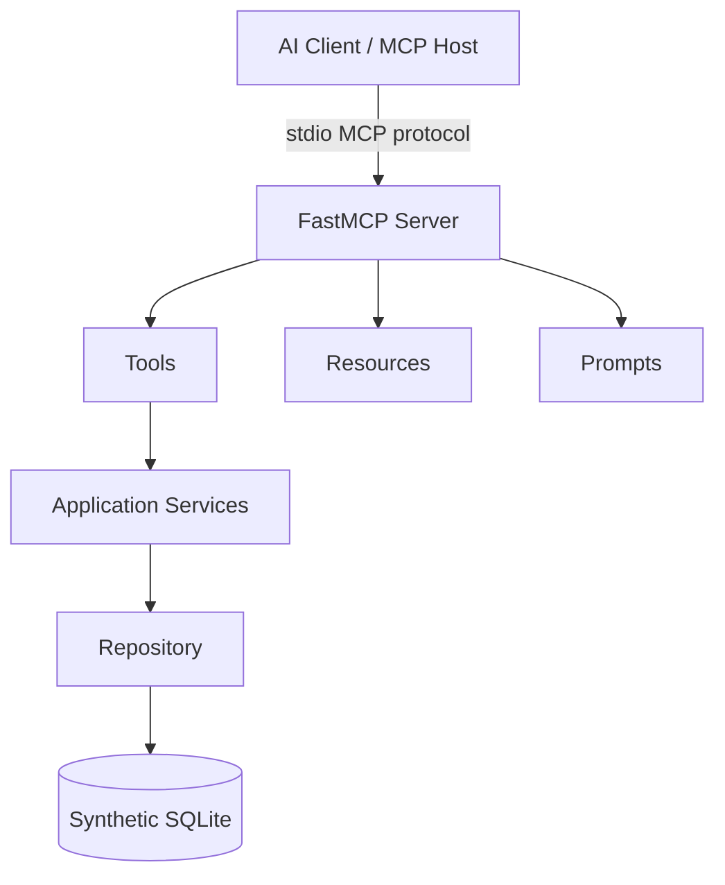

# Data Engineering MCP Server

A small, runnable Model Context Protocol server for data-engineering investigation workflows. It uses the official MCP Python SDK, Pydantic validation, SQLite synthetic data, and a service/repository architecture that is easy to study and replace with production adapters.

## What MCP Is

MCP is an open protocol that lets an AI host discover and use external context and capabilities through a standard server interface. This project demonstrates all three primitives:

| Primitive | Meaning | Example |
|---|---|---|
| Tool | An operation the model may invoke | `get_job_status` |
| Resource | Read-only context addressed by a URI | `resource://jobs` |
| Prompt | A reusable interaction template | `investigate_etl_failure` |

The MCP client discovers capabilities, chooses a tool from its schema, sends structured arguments, and receives structured content. MCP is complementary to function calling: function calling is usually a model/API feature, while MCP standardizes how tools and context are exposed by an external server and reused by many hosts.

## Problem And Solution

Data engineers repeatedly inspect ETL status, logs, schemas, incidents, runbooks, and read-only data. This server exposes those operations once so an MCP-compatible AI client can use them without a custom integration for every application.



## Tools

- `get_job_status(job_name)`: latest status, run time, duration, and records.
- `get_job_logs(job_name, run_id, severity, limit)`: bounded structured logs.
- `get_job_history(job_name, days)`: recent executions.
- `get_database_schema(table_name)`: columns, types, nullability, keys, and indexes.
- `validate_sql(sql)`: accepts one `SELECT` or `WITH` statement only.
- `execute_readonly_sql(sql, limit)`: validates and executes a bounded read-only query.
- `search_documentation(query, top_k)`: searches synthetic runbooks.
- `search_incidents(query, limit)`: searches historical synthetic incidents.
- `analyze_job_failure(job_name, run_id)`: deterministic evidence gathering, not an autonomous agent.

All tool errors are structured and internal stack traces are kept in server logs. Audit logs include request ID, tool, status, duration, and non-sensitive argument metadata.

## Resources And Prompts

Resources: `resource://jobs`, `resource://incidents`, `resource://database/schema`, and `resource://documentation`. A resource provides contextual read-only data; it does not perform an action or decide how the data should be used.

Prompts: `investigate_etl_failure(job_name, run_id)` and `analyze_sql(sql)`. A prompt is a reusable workflow instruction for an MCP host. It guides tool selection but does not itself execute the investigation.

## Quick Start

```powershell
python -m venv .venv
.\.venv\Scripts\Activate.ps1
python -m pip install -e ".[dev]"
python scripts/init_db.py
python -m data_engineering_mcp.server
```

The server uses stdio, so it should be launched by an MCP host rather than opened in a browser. Run the real MCP client demo with:

```powershell
python -m data_engineering_mcp.client_demo
```

The demo initializes an MCP session, lists tools/resources/prompts, and invokes three tools. The core project requires no LLM API key.

## Docker

```powershell
docker compose up --build
```

The compose service is intentionally stdio-oriented. An MCP host that supports launching container commands can run the container as its MCP server process. An HTTP transport can be added later when a deployment target requires a remotely reachable server.

## Configuration And Safety

Copy `.env.example` to `.env` for local overrides. Only synthetic data is included. Credentials are never returned by schema tools and `.env`/SQLite files are ignored by Git.

SQL execution is defense-in-depth: it accepts only a single `SELECT` or `WITH`, rejects write and administrative keywords, uses parameterized repository queries for application operations, and enforces a row limit. The demo uses SQLite and a short connection timeout; production should add a dedicated read-only database identity and a database-enforced statement timeout.

## Data And Tests

The seed creates 10 ETL jobs, 120 executions, 360 logs, 35 incidents, 10 documents, and relational sample tables (`customers`, `products`, `orders`, `order_items`).

```powershell
python -m pytest -q
```

The 20 evaluation scenarios are in `evaluation/scenarios.json`. They cover status, failure analysis, schema, searches, safe SQL, bounded queries, invalid input, and error cases. A full production evaluation would also measure tool-selection accuracy, argument accuracy, latency, and false-positive SQL rejection.

## Architecture And Production Evolution

The MCP decorators are adapters only. The path is `MCP tool -> service -> repository -> database`, so replacing synthetic SQLite with PostgreSQL, a monitoring API, Confluence, Jira, or Azure adapters does not require rewriting the MCP layer. The current integrations are synthetic; no real vendor integration is claimed.

Production improvements would include authentication at the host boundary, per-tool authorization, a real read-only database role, rate limiting, query cancellation, distributed audit logs, metrics/traces, secret management, and contract tests against each adapter.

## Interview Preparation

**60-second explanation:** This is an official-SDK MCP server for data-engineering support. An MCP host discovers nine typed tools, four read-only resources, and two reusable prompts over stdio. Tools call Pydantic-validated application services backed by synthetic SQLite. SQL is restricted to bounded read-only queries, errors are structured, and audit logs capture request metadata.

**Five-minute architecture:** The host starts the stdio server and initializes an MCP session. FastMCP publishes schemas and capability metadata. The host selects a tool and sends JSON arguments. The tool adapter calls a service, which validates policy and delegates to a repository. The repository uses SQLite. Results return as structured JSON content. Resources expose catalogs by URI, while prompts provide reusable workflows. In production, adapters can target monitoring, warehouse, documentation, and incident systems independently.

**Common interview answers:** MCP is a reusable protocol boundary, not an LLM; a server exposes capabilities and a client/host consumes them; tools are action-oriented, resources are contextual, and prompts are workflow templates. Security comes from narrow schemas, authorization, read-only identities, limits, timeouts, validation, and audit logs. If a tool fails, the client receives a safe structured error while detailed diagnostics stay server-side. Scale by making services stateless, moving state to managed stores, adding connection pooling and rate limits, and horizontally scaling transport workers. MCP is not needed for a single internal function call or when a stable ordinary API already fully solves the integration.

**Difficult questions to practice:** How is tool discovery different from REST documentation? Where should authorization run? How do you prevent prompt injection from tool output? How do you handle pagination? How do you version schemas? How do you cancel long queries? How do you test host compatibility? How do you trace one request across tools? How do you isolate tenants? How do you handle partial failure? How do you select a read replica? How do you prevent data exfiltration? How do you rotate secrets? How do you cache resources safely? How do you roll out a breaking tool change?

**Scenario questions:** diagnose a timeout, explain a schema mismatch, reject an unsafe query, handle an unknown run, select between a resource and a tool, investigate an incident with evidence, control a high-cost query, recover from a downstream outage, explain a failed prompt workflow, and migrate SQLite to PostgreSQL.

## GitHub And Resume Notes

```powershell
git init
git add .
git commit -m "Build data engineering MCP server"
git branch -M main
```

Resume bullets: built an official MCP Python server exposing typed data-engineering tools, resources, and prompts; implemented read-only SQL policy, bounded execution, structured errors, and audit logging; generated deterministic synthetic ETL data and an MCP stdio client with pytest coverage and Docker packaging.

## Limitations

This is a local portfolio and interview project. It does not provide real cloud, warehouse, Jira, Confluence, authentication, or LLM integrations. SQLite is suitable for study and deterministic tests, not a high-concurrency production control plane.